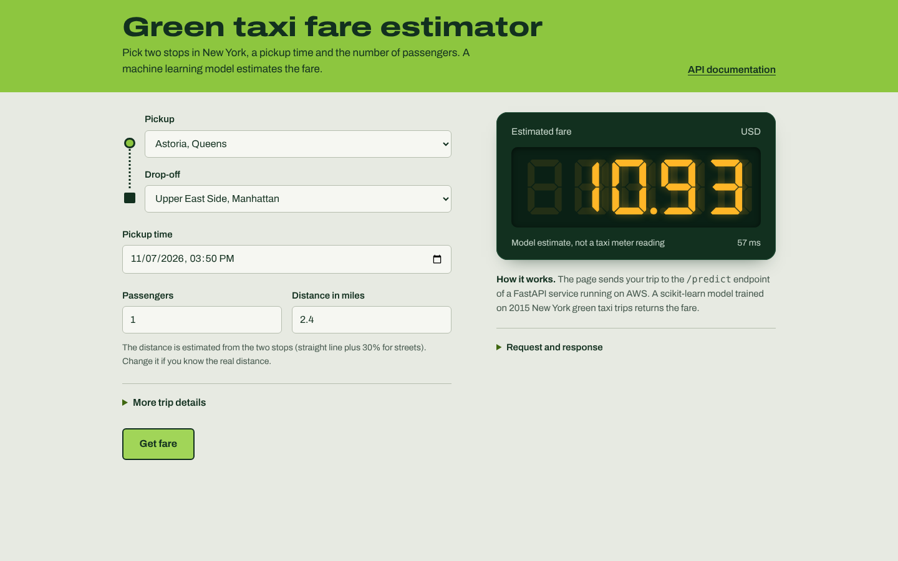
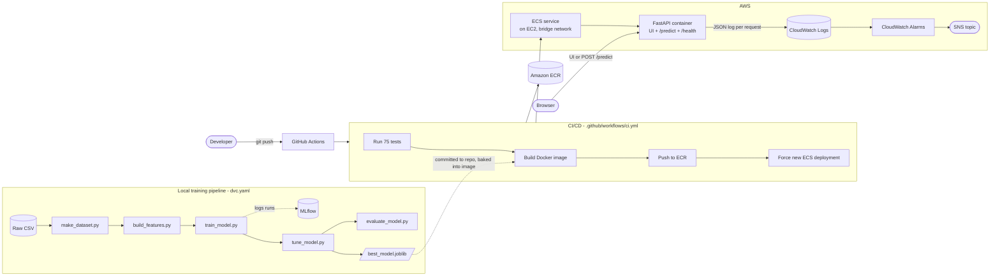

# Green Taxi Fare Prediction

[](https://github.com/Shahzaibabdulkhaliq0/Green-Taxi-Fare-Prediction/actions/workflows/ci.yml)

An end-to-end MLOps project: a scikit-learn model that predicts the fare of a
New York City green taxi trip, served by a FastAPI API with a web UI, built
by a DVC pipeline, and shipped to AWS by a GitHub Actions pipeline that tests,
builds, pushes and deploys on every push to `master`.



## Live demo

The API runs on an AWS EC2/ECS instance whose public IP can change on
restart. Get the current one and open it:

```bash
aws ec2 describe-instances \
  --filters "Name=instance-state-name,Values=running" \
            "Name=tag:aws:cloudformation:stack-name,Values=Infra-ECS-Cluster-green-taxi-cluster-4e1486ef" \
  --query "Reservations[].Instances[].PublicIpAddress" --output text
```

Then open `http://<that-ip>:8000/` for the UI, or `http://<that-ip>:8000/docs`
for the interactive API docs. The service is paused outside of demos to
avoid running up AWS costs — see [Running locally](#running-locally) for a
version that always works.

## What this demonstrates

| Area | What's implemented |
| --- | --- |
| Data pipeline | 5-stage [DVC](https://dvc.org) pipeline (`dvc.yaml`), parameterised by `params.yaml` |
| Experiment tracking | [MLflow](https://mlflow.org) logs every model comparison, tuning and evaluation run |
| Model serving | [FastAPI](https://fastapi.tiangolo.com) + Pydantic request validation, a scikit-learn pipeline (imputing, one-hot encoding, `RandomForestRegressor`) |
| Containerisation | Multi-stage-free `Dockerfile`, Gunicorn + Uvicorn workers |
| CI/CD | GitHub Actions: test → build → push to Amazon ECR → deploy to Amazon ECS, using short-lived AWS credentials (OIDC, no stored access keys) |
| Infrastructure | Amazon ECS (EC2 launch type) behind an Auto Scaling Group, Amazon ECR, IAM |
| Monitoring | Structured JSON logs per prediction, shipped to CloudWatch Logs; 3 CloudWatch alarms (prediction errors, high latency, high memory) wired to an SNS topic |
| Data drift | An [Evidently](https://www.evidentlyai.com) report comparing training data to live prediction inputs (`src/monitoring/drift_report.py`) |
| Testing | 75 pytest tests: pipeline stages, model/API contract, input validation, monitoring logs |

## Architecture



## API reference

| Method | Path | Purpose |
| --- | --- | --- |
| `GET` | `/` | Web UI (`src/api/static/index.html`) |
| `GET` | `/health` | Liveness check, used by monitoring |
| `GET` | `/docs` | Interactive Swagger UI |
| `POST` | `/predict` | Predict a fare for one trip |

`POST /predict` example:

```bash
curl -X POST http://localhost:8000/predict \
  -H "Content-Type: application/json" \
  -d '{
    "vendorid": 2,
    "Store_and_fwd_flag": "N",
    "rate_code": 1,
    "Pickup_longitude": -73.95,
    "Pickup_latitude": 40.75,
    "Dropoff_longitude": -73.98,
    "Dropoff_latitude": 40.76,
    "Passenger_count": 1,
    "Trip_distance": 3.5,
    "Trip_type": 1,
    "pickup_hour": 14,
    "pickup_weekday": 2,
    "pickup_month": 6
  }'
# {"predicted_fare": 10.93, "currency": "USD"}
```

## Running locally

**With Docker** (closest to production):

```bash
docker build -t green-taxi .
docker run -p 8000:8000 green-taxi
```

**Without Docker:**

```bash
pip install -r requirements.txt
uvicorn src.api.main:app --reload
```

Either way, open `http://localhost:8000/` for the UI or `http://localhost:8000/docs`
for the API docs.

## Retraining the model

```bash
pip install -r requirements.txt
dvc repro          # runs all 5 pipeline stages end to end
mlflow ui          # inspect runs at http://localhost:5000 (reads ./mlflow.db)
```

`dvc repro` only re-runs stages whose inputs changed (tracked via `dvc.lock`).
Edit `params.yaml` to change the train/test split, feature list or the
hyperparameter search grid.

## Testing

```bash
pip install -r requirements.txt
pytest -v
```

75 tests cover each pipeline stage (`src/data`, `src/features`, `src/models`),
the FastAPI contract (`/predict` input validation, model/API column
agreement, a real-model smoke test), and the prediction logging used for
monitoring.

## CI/CD pipeline

Every push and pull request runs `.github/workflows/ci.yml`:

1. Install dependencies and run `pytest`.
2. Confirm `models/best_model.joblib` is present (fails fast instead of
   shipping an image that would 503 on `/predict`).
3. Build the Docker image.
4. **On `master` only:** authenticate to AWS via OIDC (no long-lived AWS
   keys stored in GitHub), push the image to Amazon ECR, then run
   `aws ecs update-service --force-new-deployment` and wait for the ECS
   service to stabilise.

Pull requests build and test the image but never touch AWS.

## Monitoring

Every call to `/predict` writes one JSON line to stdout (`event`,
`latency_ms`, `predicted_fare`, the full input). ECS ships container stdout
to the `/ecs/green-taxi-api` CloudWatch Logs group. Three CloudWatch alarms
watch it and page an SNS topic (`green-taxi-alerts`):

- `green-taxi-prediction-errors` — any `/predict` returning 500/503
- `green-taxi-high-latency` — average prediction latency above 500 ms
- `green-taxi-service-memory-high` — ECS service memory above 80%

To check for data drift between training data and what the live API has
actually received:

```bash
pip install -r requirements-monitoring.txt
aws logs filter-log-events --log-group-name /ecs/green-taxi-api \
  --filter-pattern '{ $.event = "prediction" }' --region eu-north-1 \
  > reports/prediction_logs.json
python src/monitoring/drift_report.py   # writes reports/drift_report.html
```

## Project structure

```
├── .github/workflows/ci.yml   <- test, build, push to ECR, deploy to ECS
├── src/
│   ├── data/make_dataset.py        <- load, clean, split raw data
│   ├── features/build_features.py  <- feature engineering
│   ├── models/
│   │   ├── train_model.py          <- compare models, log to MLflow
│   │   ├── tune_model.py           <- GridSearchCV on the best model
│   │   ├── evaluate_model.py       <- test-set metrics
│   │   └── predict_model.py
│   ├── monitoring/drift_report.py  <- Evidently data drift report
│   └── api/
│       ├── main.py                 <- FastAPI app
│       └── static/index.html       <- web UI
├── tests/                      <- 75 pytest tests
├── dvc.yaml, params.yaml       <- pipeline stages and their parameters
├── models/best_model.joblib    <- trained pipeline (committed; see Known limitations)
└── Dockerfile
```

## Tech stack

Python, pandas, scikit-learn, MLflow, DVC, FastAPI, Pydantic, Gunicorn,
Uvicorn, Docker, pytest, Evidently, GitHub Actions, Amazon ECR, Amazon ECS,
Amazon EC2, Amazon CloudWatch, Amazon SNS, IAM (OIDC).

## Known limitations

Built as a learning project; these are the honest gaps rather than
oversights:

- **Tuning grid is intentionally small** (`params.yaml` →
  `hyperparameter_tuning`) so the full pipeline runs in seconds for demos.
  The shipped model is under-tuned; widening the grid and re-running
  `dvc repro` would materially improve accuracy.
- **DVC remote is configured but not yet the source of truth.** An S3
  remote exists; the model is currently committed straight to Git as a
  stopgap rather than pulled via `dvc pull` in CI.
- **MLflow tracking is local only** (`sqlite:///mlflow.db`), not shared
  between contributors or backed by a model registry.
- **No auto-retraining.** Retraining is a manual `dvc repro` + redeploy.
- **Infrastructure is hand-configured**, not Terraform/IaC, so the AWS
  setup isn't fully reproducible from code yet.
- **No load balancer** — the ECS task's host port is fixed, so only one
  copy runs per instance, and the public IP changes if the instance is
  replaced.

## License

See [LICENSE](LICENSE).
